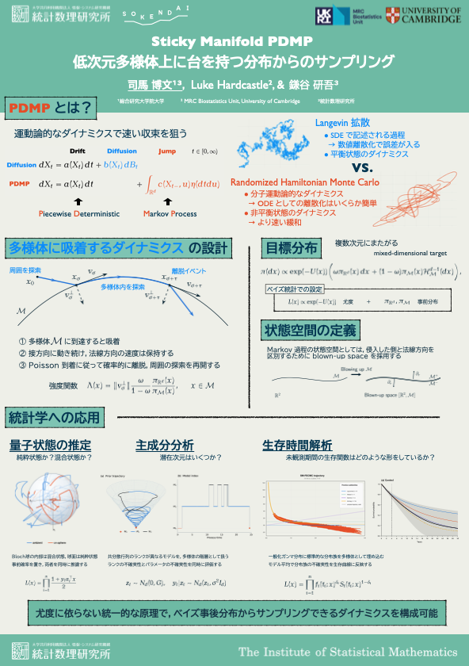

## [異分野異業種研究交流会](https://jsiam.org/jsiam_archive/kr/career2026/)

| Date | Location |
|:------:|:---:|
| October 30th, 14:00-15:30 | 東京大学 駒場キャンパスⅠ 21 KOMCEE West 地下1階MMホール |

: ポスター発表時刻 {.active .hover .bordered .responsive-sm tbl-colwidths="[10,20]"}

