## Scaling Analysis of Two PDMPs {.unnumbered .unlisted}

* @sec-1 $\;$[Introduction]{.underline}:$\;$Energy / radial mixing in MCMC

    `A hidden scandal' in MCMC literature

* @sec-2 $\;$[Main Result]{.underline}:$\;$Analytic expression for Green--Kubo coefficient

    which leads to a rigorous ordering result that [**FECMC**]{.color-unite} always performs better than [**BPS**]{.color-blue}

* @sec-3 $\;$[Future direction]{.underline}
  
  Fast asymptotic variance / ESS estimation & **Sticky Manifold [FECMC]{.color-unite}**

## MCMC Analysis in Statistics {#sec-1}

:::: {.columns style="text-align: center;"}
::: {.column width="33%"}
![[Random Walk<br>(1953--)]{.large-letter}](ISM/RWMH2.gif)
:::

::: {.column width="33%"}
![[Langevin Diffusion]{.medium-letter .color-blue}<br>[(1978--)]{.large-letter .color-blue}](ISM/LMC.gif)
:::

::: {.column width="33%"}
![[PDMP<br>(2008--)]{.large-letter .color-unite}](ISM/FECMC.gif)
:::
::::

### [**P**]{.color-unite}iecewise-[**D**]{.color-unite}eterministic [**M**]{.color-unite}arkov [**P**]{.color-unite}rocess

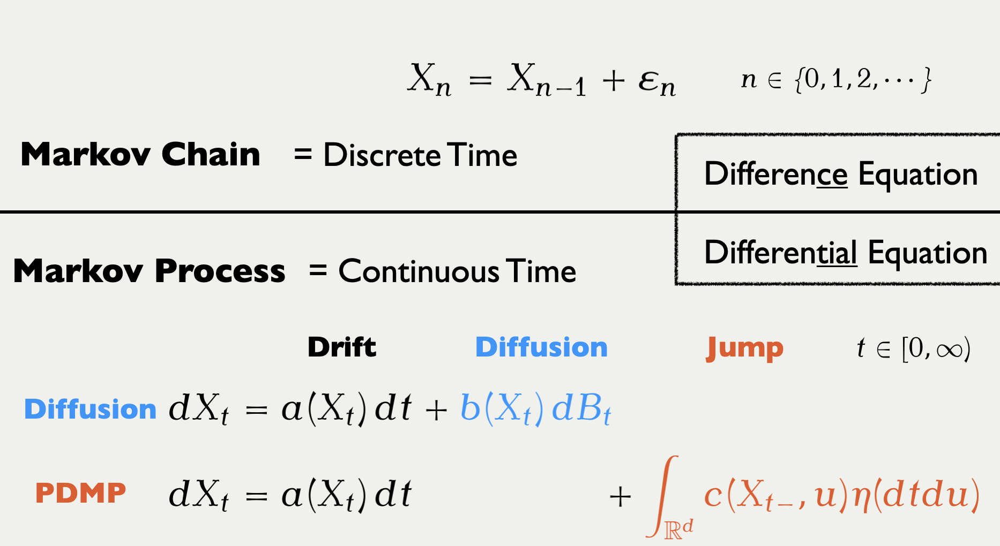{fig-align="center"}

:::: {.columns style="text-align: center;"}

::: {.column width="45%"}
![[Langevin Diffusion]{.color-blue}](ISM/LMC_横長.gif)
:::

::: {.column width="45%"}
![[Randomized Hamiltonian Monte Carlo]{.color-unite}](ISM/RHMC_横長.gif)
:::

::::

### Example Algorithms within the PDMP Framework

:::: {.columns style="text-align: center;"}
::: {.column width="33%"}
![Zig-Zag Sampler<br>[@Bierkens+2019]](NOREMIA/zig_zag.gif)
:::

::: {.column width="33%"}
![Bouncy Particle Sampler<br>[@Bouchard-Cote+2018]](NOREMIA/bouncy_particle.gif)
:::

::: {.column width="33%"}
![Forward ECMC<br>[@Michel+2020]](NOREMIA/forward_ecmc.gif)
:::
::::

:::: {.columns style="text-align: center;"}
::: {.column width="33%"}
![Boomerang Sampler<br>[@Bierkens+2020]](NOREMIA/boomerang.gif)
:::

::: {.column width="33%"}
![Sticky Zig-Zag Sampler<br>[@Bierkens+2023]](NOREMIA/sticky_zig_zag.gif)
:::

::: {.column width="33%"}
![Sticky-Manifold Sampler<br>[@Shiba+2026]](NOREMIA/sticky_manifold.gif)
:::
::::

### Markov Chain Monte Carlo

computes space averages as time averages

{fig-align="center"}

### Efficiency Depends on the Functionals

::: {.r-stack}

{width="100%"}

{.fragment width="100%"}

:::

### [Effective Sample Size]{.color-unite}<br>= Statisticians' term for [integrated autocorrelation time]{.color-blue}

For an observable $f$, the [**integrated autocorrelation time**]{.color-blue} is
$$
\textcolor{#0096FF}{\tau_{\mathrm{int},\textcolor{#062e4b}{f}}}:=\frac12+\sum_{k=1}^{\infty}\rho_f(k),
$$
while the [**effective sample size**]{.color-unite} is
$$
\textcolor{#E95420}{\operatorname{ESS}_{\textcolor{#062e4b}{f}}}:=\frac{T}{2\textcolor{#0096FF}{\tau_{\mathrm{int},\textcolor{#062e4b}{f}}}}.
$$
When the chain is started in stationarity,
$$
\operatorname{Var}(\hat f_T)
\sim
\frac{2\textcolor{#0096FF}{\tau_{\mathrm{int},\textcolor{#062e4b}{f}}}}{T}
\operatorname{Var}_{\pi}(f)=\frac{\operatorname{Var}_{\pi}(f)}{\textcolor{#E95420}{\operatorname{ESS}_{\textcolor{#062e4b}{f}}}}\qquad(T\to\infty).
$$

::: {style="padding: 0 0.7em; border: 1px solid #DCA990; border-left: 4px solid #E95420; border-radius: 0.2em; background-color: #F8EFE8;"}
When $\textcolor{#E95420}{\operatorname{ESS}_{\textcolor{#062e4b}{f}}}/T<1$, the asymptotic variance is [inflated]{.color-unite} from the i.i.d. case because of the positive correlation within the MCMC.
:::



### MCMC Scaling Analysis Initiated by @Roberts+1997

identifies computational complexity scaling for i.i.d. targets of dimension $d\to\infty$

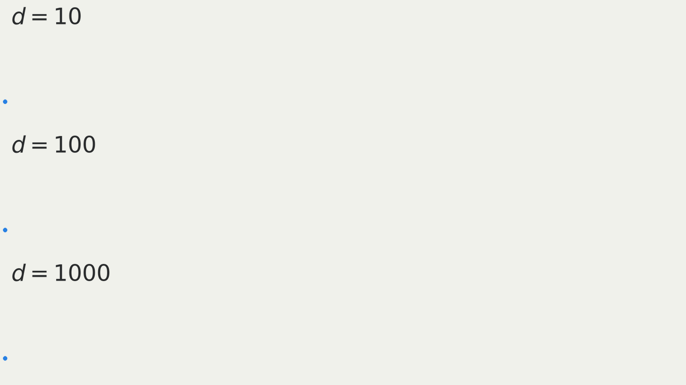{fig-align="center"}

$$
\textcolor{#0096FF}{\text{Diffusion limit}:}\quad d\textcolor{#0096FF}{X_t}=-\frac{h(\ell)}2\textcolor{#0096FF}{X_t}\,dt+\sqrt{h(\ell)}\,dB_t,
$$
where $h(\ell)=2\ell^2\Phi(-\ell/2)$ with $\ell$ being the step size.

### Optimal Acceptance Rates [@Roberts-Rosenthal1998]

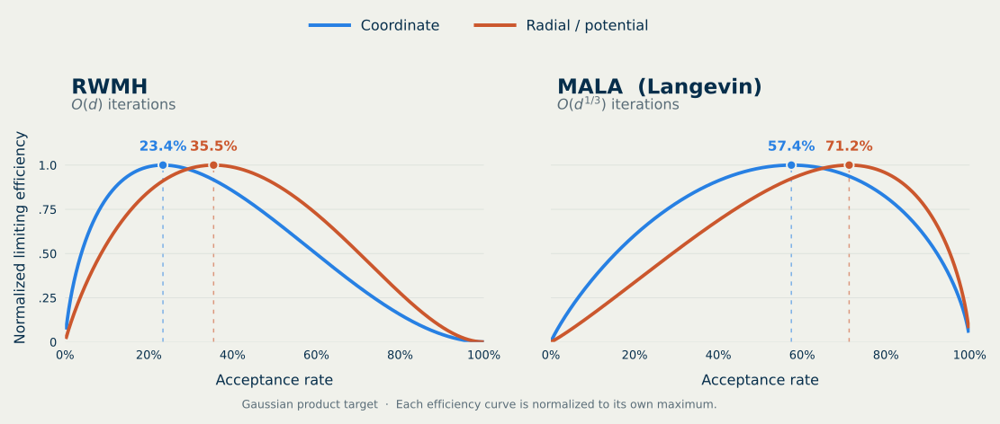

$$
\textcolor{#0096FF}{\text{first coordinate:}\quad f(x)=x_1},\quad\textcolor{#E95420}{\text{potential:}\quad f(x)=\sum_{i=1}^dU_i(x_i)},
$$

### A Hidden Scandal: Optimal Acceptance Rates for What? {style="font-size: var(--r-main-font-size);"}

::: {.scaling-table}
| Sampler | Coordinate | Radial / potential |
|:--:|:--:|:--:|
| RWM | $O(d^2)$<br>[@Roberts+1997] | $O(d^2)$<br>(conjecture) |
| [MALA]{.color-blue} | $\textcolor{#0096FF}{O(d^{4/3})}$<br>[@Roberts-Rosenthal1998] | $\textcolor{#0096FF}{O(d^{4/3})}$<br>(conjecture)
| [HMC]{.color-yellow} | $\textcolor{#895E10}{O(d^{5/4})}$<br>[@Beskos+2013] | $\textcolor{#895E10}{O(d^{5/4})}$<br>(conjecture)

: High-dimensional scaling for product targets.
:::

### PDMP Shows Different Scaling Depending on Functionals {style="font-size: var(--r-main-font-size);"}

::: {#pdmp-scaling .scaling-table .r-stack style="position: relative;"}
| Sampler | Coordinate | Radial / potential |
|:--:|:--:|:--:|
| [BPS]{.color-blue} $\textcolor{#0096FF}{\lambda_{\mathrm{ref}}=\Theta(d^{-1/2})}$ | $\textcolor{#0096FF}{O(d^{3/2})}$<br>[@Deligiannidis+2021] | $\textcolor{#0096FF}{O(d^{5/2})}$<br>[(conjecture)]{.bps-note} |
| [BPS]{.color-blue} $\textcolor{#0096FF}{\lambda_{\mathrm{ref}}=\Theta(1)}$ | $\textcolor{#0096FF}{O(d^{2})}$<br>[@Bierkens-Kamatani-Roberts2022] | $\textcolor{#0096FF}{O(d^{2})}$<br>[@Bierkens-Kamatani-Roberts2022] |
| [FECMC]{.color-unite} | $\textcolor{#E95420}{O(d^{3/2})}$<br>(conjecture) | $\textcolor{#E95420}{O(d^2)}$<br>[@Shiba-Kamatani2026] |

: [@Nishikawa+2015] and [@Lei-Krauth2018] observe a related scale difference in the Heisenberg model.

```{=html}
<style>
#pdmp-scaling td > :is(.citation, .bps-note) {
  position: relative;
  z-index: 2;
  background-color: inherit;
}
</style>

<div class="fragment" aria-hidden="true"
     style="position: absolute; left: 66.5%; top: 36%;
            width: 52%; height: 26%; box-sizing: border-box;
            border: 3px solid #E95420; border-radius: 50%;
            transform: translate(-50%, -50%) rotate(18deg);
            mix-blend-mode: normal; pointer-events: none; z-index: 3;"></div>
```
:::

### Empirical Comparison of Radial Mixing: [BPS]{.color-blue} vs. [FECMC]{.color-unite} {#sec-comparison}

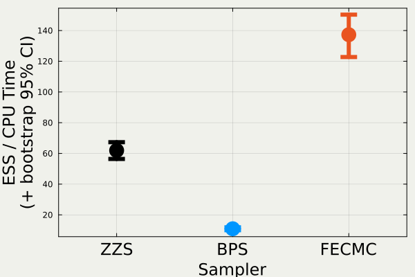

## A Scaling Analysis of Potentials {#sec-2}

We compare two PDMP methods under the following condition:

* ODE: Linear flow
* Jump: [Reflection + Refreshment]{.color-blue} vs. [Combination]{.color-unite}
* Target: High dimensional standard Gaussian $U(x):=-\log\pi(x)=\|x\|^2/2$.

{fig-align="center"}

### [BPS]{.color-blue} vs. [FECMC]{.color-unite}: Which is Most Efficient? {#sec-FECMC-vs-BPS}

:::: {.columns}

::: {.column width="33%"}
![[Bouncy Particle Sampler]{.color-blue}<br>[@Bouchard-Cote+2018]](ISM/BPS_1.0_Trajectory.gif)
:::

::: {.column width="33%"}
![[BPS]{.color-blue} with different hyperparameter $\rho$](ISM/BPS_10.0_Trajectory.gif)
:::

::: {.column width="33%"}
![[Forward Event Chain Monte Carlo]{.color-unite} [@Michel+2020]](ISM/FECMC_0.0_Trajectory.gif)
:::

::::

### Jump Mechanisms in [BPS]{.color-blue} vs. [FECMC]{.color-unite}

:::: {layout="[32,2,32,2,32]" layout-valign="center"}

![[Reflection]{.color-blue .medium-letter}](NOREMIA/BPS_reflection.gif)

::: {style="text-align: center;"}
$\Large +$
:::

![[Refreshment $\rho$]{.color-blue .medium-letter}](NOREMIA/BPS_refreshment.gif)

::: {style="text-align: center;"}
$\Large\fallingdotseq$
:::

![[Stochastic Reflection]{.color-unite .medium-letter}](NOREMIA/FECMC.gif)

::::

### Scaling Analysis of PDMPs

aims to identify the scaling factor $\textcolor{#E95420}{d^{\textrm{\,some \,factor}}}$ that yields a diffusion limit as $d\to\infty$

$$
\text{Plotting } \textcolor{#0096FF}{Y_t^{(d)}}=\frac{\|\textcolor{#0096FF}{X}_{\textcolor{#E95420}{d}\textcolor{#0096FF}{t}}^{\textcolor{#0096FF}{(d)}}\|^2-d}{\sqrt{d}} \text{ with } d=10^2,10^3,10^4:
$$

{fig-align="center"}

### Theorem 1: Diffusion Limits of the Rescaled Energy

:::: {.columns style="text-align: center;"}

::: {.column width="50%"}
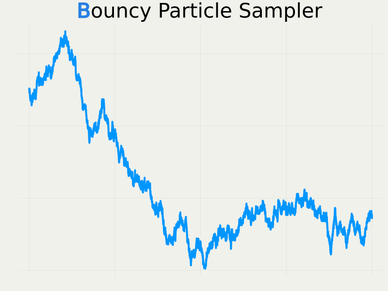

$$
dY_t^{\textcolor{#0096FF}{\text{B}}}=-\frac{\sigma^2_{\textcolor{#0096FF}{\text{B}}}(\rho)}{4}Y_t^{\textcolor{#0096FF}{\text{B}}}\,dt+\sigma_{\textcolor{#0096FF}{\text{B}}}(\rho)\,dB_t
$$
$$
\sigma^2_{\textcolor{#0096FF}{\text{B}}}(\rho)=8\int^\infty_0e^{-\rho s}\E[R_0^{\textcolor{#0096FF}{\text{B}}}R_s^{\textcolor{#0096FF}{\text{B}}}]\,ds
$$
:::

::: {.column width="50%"}
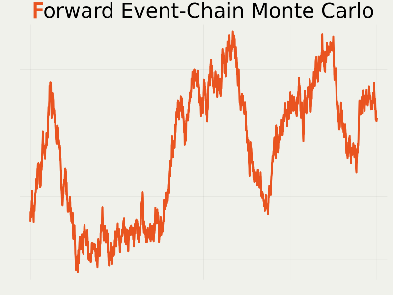

$$
dY_t^{\textcolor{#E95420}{\text{F}}}=-\frac{\sigma^2_{\textcolor{#E95420}{\text{F}}}(\rho)}{4}Y_t^{\textcolor{#E95420}{\text{F}}}\,dt+\sigma_{\textcolor{#E95420}{\text{F}}}(\rho)\,dB_t
$$
$$
\sigma^2_{\textcolor{#E95420}{\text{F}}}(\rho)=8\int^\infty_0e^{-\rho s}\E[R_0^{\textcolor{#E95420}{\text{F}}}R_s^{\textcolor{#E95420}{\text{F}}}]\,ds
$$

:::

::::

### Theorem 2: Analytic Expressions of $\sigma^2$

<!-- $$
\sigma^2_{\textcolor{#E95420}{\text{FECMC}}}(0)=\sqrt{\frac{32}{\pi}},\quad\sigma^2_{\textcolor{#0096FF}{\text{BPS}}}(0)=0,
$$ -->
<br>

$$
\begin{align*}
\sigma^2_{\textcolor{#E95420}{\text{FECMC}}}(\rho)&=\sqrt{\frac{32}{\pi}}\Paren{1-\frac{\paren{\rho^2-\rho\sqrt{\frac{\pi}{2}}+\Omega(\rho)}^2}{\rho^4\Omega(\rho)(2-\Omega(\rho))}},\quad\rho>0\\
\sigma^2_{\textcolor{#0096FF}{\text{BPS}}}(\rho)&=\frac{8}{\rho^4}\paren{\rho^3-\rho^2\sqrt{\frac{8}{\pi}}+\rho-\sqrt{\frac{8}{\pi}}\frac{\paren{(1+\rho^2)\Omega(\rho)-\rho^2}^2}{\Omega(2\rho)}},
\end{align*}
$$
<br><br>
where
$$
\Omega(\rho)\coloneqq\sqrt{\frac{\pi}{2}}\rho\operatorname{erfcx}\paren{\frac{\rho}{\sqrt{2}}}=\rho e^{\frac{\rho^2}{2}}\int^\infty_\rho e^{-\frac{t^2}{2}}\,dt
$$
satisfies $\Omega(\rho)=1-\E[e^{-\rho\tau}]$ for $\tau\sim\operatorname{Rayleigh}(1)$.

::: aside
Don't worry; I will plot them in the next slide...
:::

### Theorem 2 (cont.): Plot of $\sigma^2$

![While [BPS]{.color-blue} atteins maximum at non-trivial value of $\rho$, [FECMC]{.color-unite} achieves maximum at $\rho=0$](ISM/sigma.svg){fig-align="center"}


### A Slow-Fast Structure with the Radial Momentum $\textcolor{#00A381}{R}$

The hypocoercivity / slow-fast structure behind this diffusion limit comes from

* The potential $\textcolor{#E95420}{U(X_t)}=\|X_t\|^2/2$ evolves on a slow timescale.
* Its time derivative $\textcolor{#00A381}{R_t}:=(X_t|V_t)=d\textcolor{#E95420}{U(X_t)}/dt$ fluctuates on a fast timescale.

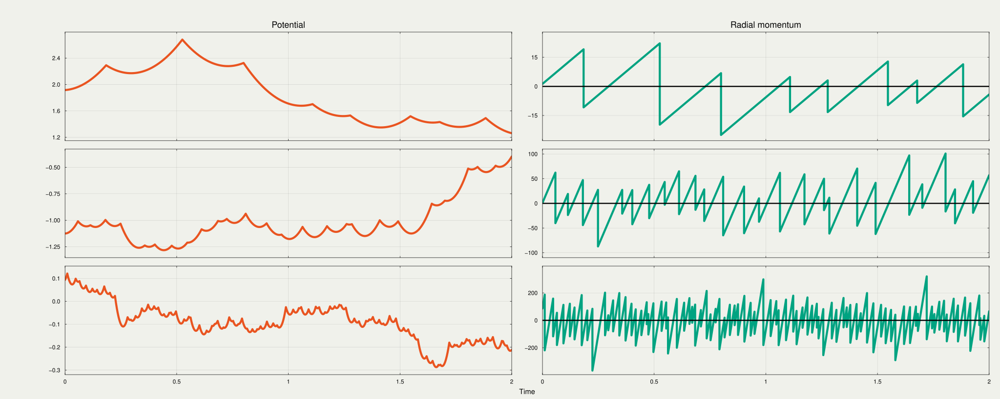{fig-align="center"}

### $\sigma^2$ as the CLT Variance of Time-Derivative $\textcolor{#00A381}{R}$

Theorem 1 showed
$$
\begin{align*}
\frac{\sigma^2(\rho)}{4}=2\int^\infty_0e^{-\rho t}\E[\textcolor{#00A381}{R_0R_t}]\,dt=\lim_{T\to\infty}\frac{1}{T}\operatorname{Var}\left[\int^T_0\textcolor{#00A381}{R_t^{(\rho)}}\,dt\right].
\end{align*}
$$

→ $\sigma^2/4$ is the **asymptotic variance** of the ergodic average of $\textcolor{#00A381}{R_t^{(\rho)}}$.

![The [radial process]{.color-MyGreen} accumulation translates into the diffusion coefficient of the [potential process]{.color-unite}](NOREMIA/YandR10000.svg){fig-align="center"}

### $\sigma^2(\rho)$ and Resolvent Equations $\textcolor{#00A381}{R}$

Pushing the calculation further using Fubini's theorem,
$$
\begin{align*}
\frac{\sigma^2(\rho)}{4}=2\int^\infty_0e^{-\rho t}\E[\textcolor{#00A381}{R_0R_t}]\,dt=\lim_{T\to\infty}\frac{1}{T}\operatorname{Var}\left[\int^T_0\textcolor{#00A381}{R_t^{(\rho)}}\,dt\right].
\end{align*}
$$
$$
=2\E\SQuare{\textcolor{#00A381}{R_0}\underbrace{\int^\infty_0e^{-\rho t}\E[\textcolor{#00A381}{R_t}|\textcolor{#00A381}{R_0}]\,dt}_{=:\textcolor{#E95420}{f_\rho}(\textcolor{#00A381}{R_0})}}=2\E[\textcolor{#00A381}{R_0}\textcolor{#E95420}{f_\rho}(\textcolor{#00A381}{R_0})],
$$
where $\textcolor{#E95420}{f_\rho}$ solves the resolvent equation of $\textcolor{#00A381}{R}$
$$
\mathcal{L}_R\textcolor{#E95420}{f_\rho}(x)=\textcolor{#E95420}{f_\rho}'(x)+x_+\Paren{\E[\textcolor{#E95420}{f_\rho}(-\tau)]-\textcolor{#E95420}{f_\rho}(x)},
$$
$$
(\rho-\mathcal{L}_{R})\textcolor{#E95420}{f_\rho}(x)=x
$$

::: {style="text-align: center;"}
This is analytically solvable! [cf. @Bierkens-Lunel2022]
:::

::: aside
Recall that $\tau\sim\operatorname{Rayleigh}(1)$.
:::

### The Most Simple Case: Generalised Poisson Equation

Taking $\rho\to0$, the resolvent equation reduces to
$$
-\mathcal{L}_Rf_0(x)=x\quad\text{Generalised Poisson eq.}
$$
This can be solved in each sampler:

| Sampler | Solution | $\sigma^2(0)=8\mathbb{E}[R_0\textcolor{#E95420}{f_0}(R_0)]$ |
|:--|:-----|:----:|
| [BPS]{.color-blue} | $\displaystyle f_0^{\textcolor{#2780e3}{B}}(x)=\frac{1-x^2}{2}$ | $0$ |
| [FECMC]{.color-unite} | $\displaystyle f_0^{\textcolor{#E95420}{F}}(x)=\frac14-\frac12\min(x,0)^2$ | $\displaystyle\sqrt{\frac{32}{\pi}}$ |

<!-- The limiting mixing speed of $Y^d$, governed by $\sigma^2$, is determined by the accumulated fluctuations of the fast process $R^d$. -->

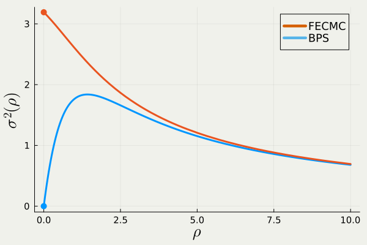{fig-align="center"}

::: aside
Kipnis-Varadhan theory [@Cattiaux+2011] can systematically guarantee a CLT and that its variance is $\sigma^2(0)$.
:::

## Two Future Directions {#sec-3}

### Asymptotic Variance Estimation for [PDMP]{.color-unite} in High Dimensions

[Fact 1: $\textcolor{#E95420}{Y_t}$ and $\textcolor{#00A381}{R_t}$ share the same information for $\sigma^2$]{.medium-letter}

$$
\frac{16}{\sigma^2}=\lim_{T\to\infty}T\operatorname{Var}\!\left[\frac1T\int_0^T \textcolor{#E95420}{Y_t}\,dt\right],
$$
$$
\sigma^2=4\lim_{T\to\infty}T\operatorname{Var}\!\left[\frac1T\int_0^T \textcolor{#00A381}{R_t}\,dt\right].
$$

[Fact 2: $\textcolor{#00A381}{R_t}$ carries $d$ times as much information as $\textcolor{#E95420}{Y_t}$]{.medium-letter}

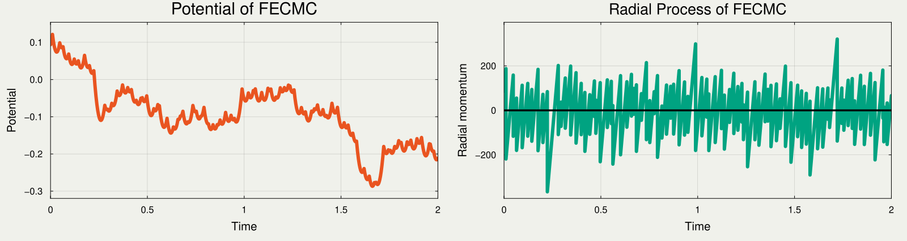{fig-align="center"}

### Experiment: QV Estimator Improves with Dimension

<style>
.reveal .qv-estimates { margin-block: var(--r-block-margin); }
.reveal .qv-estimates > p { width: 100%; height: 100%; }
.reveal .qv-estimates img { display: block; height: 100%; max-height: 100%; margin: auto; }
</style>

::: {.r-stack .r-stretch .qv-estimates}
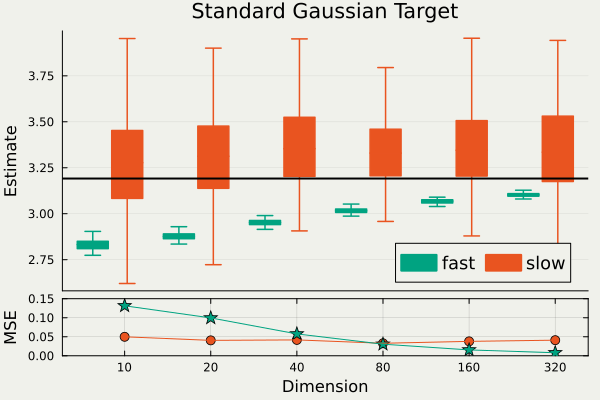{.fragment .fade-out fragment-index=0 fig-alt="Standard Gaussian target"}

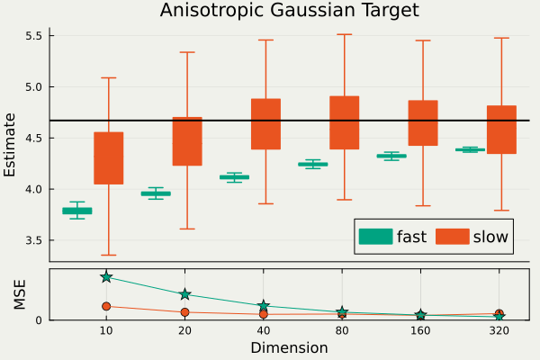{.fragment fragment-index=0 fig-alt="Anisotropic Gaussian target"}
:::

<p class="caption" style="font-size: 0.7em;">Two estimators for the CLT variance $8/\sigma^2$: [slow]{.color-unite} corresponds to the [Batch Means estimator]{.color-unite}, [fast]{.color-MyGreen} corresponds to the [Realized Variation estimator]{.color-MyGreen}</p>

### `Sticky' Dynamics for Bayesian Model Selection / Averaging

:::: {.columns style="text-align: center;"}
::: {.column width="55%"}
![Sticky Zig-Zag [@Bierkens+2023]](NOREMIA/StickyZigZag.gif)
:::

::: {.column width="45%"}
![Sticky Manifold [FECMC]{.color-unite} [@Shiba+2026]](NOREMIA/S2.gif)
:::
::::

### SM-FECMC for Quantum State Tomography

:::: {.columns}

::: {.column width="43%"}
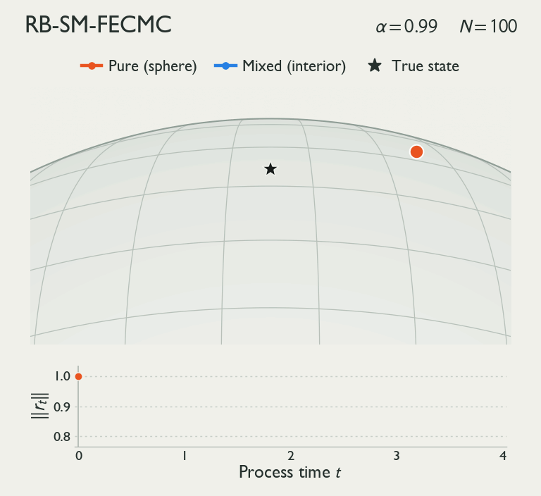{width="100%" fig-alt="RB-SM-FECMC trajectory near the true Bloch vector, with its radius over time."}
:::

::: {.column .quantum-rmse width="57%"}

<style>
.reveal .quantum-rmse { font-size: min(0.84em, 24px); text-align: left; font-variant-numeric: tabular-nums; }
.reveal .quantum-rmse table { width: calc(100% - 1em); }
.reveal .quantum-rmse :is(th, td) { padding: 0.1em 0.2em; white-space: nowrap; }
.reveal .quantum-rmse tbody td { border-bottom: 0; }
.reveal .quantum-rmse tbody tr:nth-child(4) td { border-top: 0.08em solid currentColor; }
</style>

**RMSE (units of $10^{-4}$) at $10^6$ potential/gradient evaluations**  

| $\alpha$ | Sampler | $p_{\mathrm{pure}}$ | $\mu_{\mathrm{pure}}$ | $\mu_{\mathrm{mixed}}$ | $\mathbb{E}[r\mid y]$ |
|:-----|:-----|------:|------:|-------:|--------:|
| 1.00 | **SM-FECMC** | **3.61** | **2.92** | **6.05** | **2.58** |
|      | RJ-FECMC | 9.16 | 5.82 | 10.7 | 5.95 |
|      | RJ-HMC | 11.1 | 4.40 | 11.6 | 4.02 |
| 0.99 | **SM-FECMC** | **4.10** | **3.17** | **5.44** | **2.58** |
|      | RJ-FECMC | 14.8 | 4.93 | 8.99 | 5.10 |
|      | RJ-HMC | 14.3 | 4.76 | 9.98 | 4.31 |

: From @Shiba+2026 Section 4.3

:::
::::

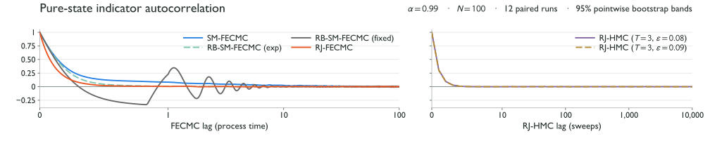{fig-align="center"}

### SM-FECMC for Principal Component Analysis

Recovering signal covariance $G$ with eigenvalues $(2, 1.9, 1.8,\cdots,0.1)$.

:::: {.columns}

::: {.column width="50%"}
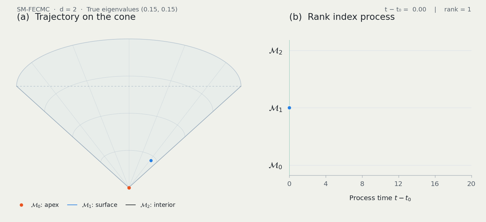{width="100%"}
:::

::: {.column width="50%"}

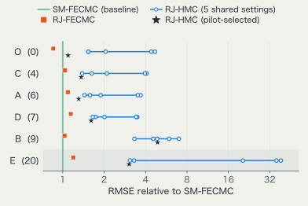{width="100%"}

:::
::::

::: {style="text-align: center;"}
The five HMC settings gave 3.1–38.5× the SM-FECMC RMSE.
:::

## References {.unlisted .unnumbered visibility="uncounted"}

::: {#refs}
:::

