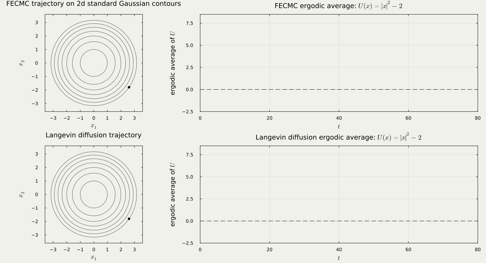
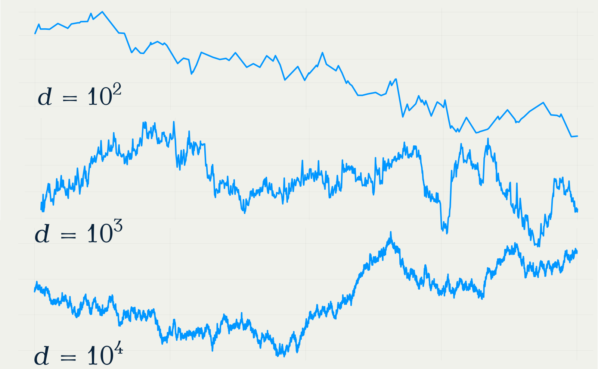
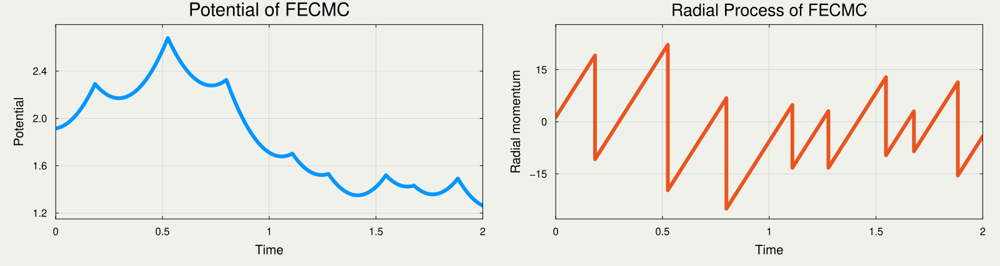
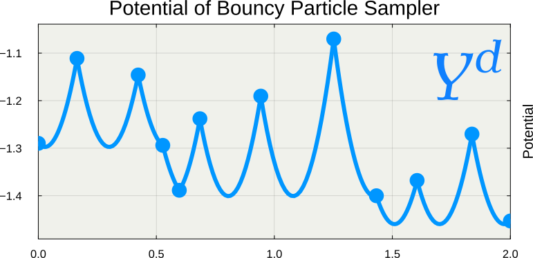
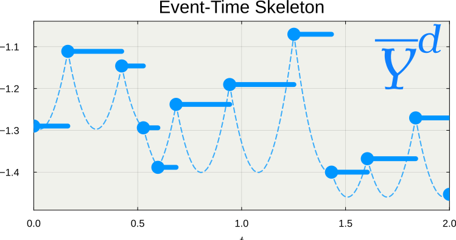
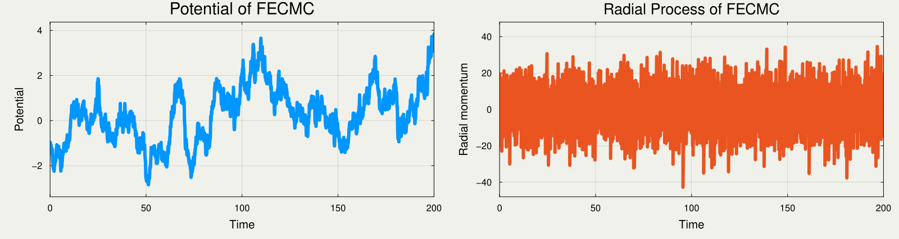
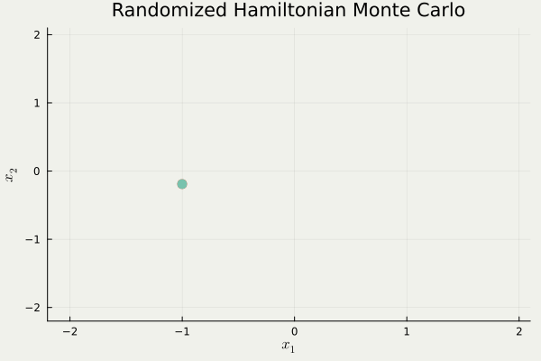

## Scaling Analysis of Two PDMPs {.unnumbered .unlisted}

* @sec-1 $\;$[Introduction]{.underline}:$\;$Energy / radial mixing in MCMC

    `A hidden scandal' in MCMC literature

* @sec-2 $\;$[Main Result]{.underline}:$\;$Analytic expression for Green--Kubo coefficient

    which leads to a rigorous ordering result that [**FECMC**]{.color-unite} always performs better than [**BPS**]{.color-blue}

* @sec-proof $\;$[Derivation]{.underline}:$\;$Solving (generalised) Poisson equation

* @sec-3 $\;$[Future direction]{.underline}:$\;$Asymptotic variance estimation (≒ ESS estimation)
  
  The **PDMP** framework allow a more efficient estimator

## MCMC Analysis in Statistics {#sec-1}

:::: {.columns style="text-align: center;"}
::: {.column width="33%"}
![[Random Walk<br>(1953--)]{.large-letter}](ISM/RWMH2.gif)
:::

::: {.column width="33%"}
![[Langevin Diffusion]{.medium-letter .color-blue}<br>[(1978--)]{.large-letter .color-blue}](ISM/LMC.gif)
:::

::: {.column width="33%"}
![[PDMP<br>(2008--)]{.large-letter .color-unite}](ISM/FECMC.gif)
:::
::::

### [**P**]{.color-unite}iecewise-[**D**]{.color-unite}eterministic [**M**]{.color-unite}arkov [**P**]{.color-unite}rocess

{fig-align="center"}

:::: {.columns style="text-align: center;"}

::: {.column width="45%"}
![[Langevin Diffusion]{.color-blue}](ISM/LMC_横長.gif)
:::

::: {.column width="45%"}
![[Randomized Hamiltonian Monte Carlo]{.color-unite}](ISM/RHMC_横長.gif)
:::

::::

### Example Algorithms within the PDMP Framework

:::: {.columns style="text-align: center;"}
::: {.column width="33%"}
![Zig-Zag Sampler<br>[@Bierkens+2019]](NOREMIA/zig_zag.gif)
:::

::: {.column width="33%"}
![Bouncy Particle Sampler<br>[@Bouchard-Cote+2018]](NOREMIA/bouncy_particle.gif)
:::

::: {.column width="33%"}
![Forward ECMC<br>[@Michel+2020]](NOREMIA/forward_ecmc.gif)
:::
::::

:::: {.columns style="text-align: center;"}
::: {.column width="33%"}
![Boomerang Sampler<br>[@Bierkens+2020]](NOREMIA/boomerang.gif)
:::

::: {.column width="33%"}
![Sticky Zig-Zag Sampler<br>[@Bierkens+2023]](NOREMIA/sticky_zig_zag.gif)
:::

::: {.column width="33%"}
![Sticky-Manifold Sampler<br>[@Shiba+2026]](NOREMIA/sticky_manifold.gif)
:::
::::

### Markov Chain Monte Carlo

computes space averages as time averages

{fig-align="center"}

### Efficiency Depends on the Functionals

::: {.r-stack}

{width="100%"}

{.fragment width="100%"}

:::

### [Effective Sample Size]{.color-unite}<br>= Statisticians' term for [integrated autocorrelation time]{.color-blue}

For an observable $f$, the [**integrated autocorrelation time**]{.color-blue} is
$$
\textcolor{#0096FF}{\tau_{\mathrm{int},\textcolor{#062e4b}{f}}}:=\frac12+\sum_{k=1}^{\infty}\rho_f(k),
$$
while the [**effective sample size**]{.color-unite} is
$$
\textcolor{#E95420}{\operatorname{ESS}_{\textcolor{#062e4b}{f}}}:=\frac{T}{2\textcolor{#0096FF}{\tau_{\mathrm{int},\textcolor{#062e4b}{f}}}}.
$$
When the chain is started in stationarity,
$$
\operatorname{Var}(\hat f_T)
\sim
\frac{2\textcolor{#0096FF}{\tau_{\mathrm{int},\textcolor{#062e4b}{f}}}}{T}
\operatorname{Var}_{\pi}(f)=\frac{\operatorname{Var}_{\pi}(f)}{\textcolor{#E95420}{\operatorname{ESS}_{\textcolor{#062e4b}{f}}}}\qquad(T\to\infty).
$$



### MCMC Scaling Analysis

identifies computational complexity scaling for i.i.d. targets of dimension $d\to\infty$

{fig-align="center"}

$$
\textcolor{#0096FF}{\text{Diffusion limit}:}\quad d\textcolor{#0096FF}{X_t}=-\frac{h(\ell)}2\textcolor{#0096FF}{X_t}\,dt+\sqrt{h(\ell)}\,dB_t,
$$
where $h(\ell)=2\ell^2\Phi(-\ell/2)$ with $\ell$ being the step size.

### Optimal Acceptance Rates of MCMC


$$
\textcolor{#0096FF}{\text{first coordinate:}\quad f(x)=x_1},\quad\textcolor{#E95420}{\text{potential:}\quad f(x)=\sum_{i=1}^dU_i(x_i)},
$$

### A Hidden Scandal: Optimal Acceptance Rates for What? {style="font-size: var(--r-main-font-size);"}

::: {.scaling-table}
| Sampler | Coordinate | Radial / potential |
|:--:|:--:|:--:|
| RWM | $O(d^2)$<br>[@Roberts+1997] | $O(d^2)$<br>(conjecture) |
| [MALA]{.color-blue} | $\textcolor{#0096FF}{O(d^{4/3})}$<br>[@Roberts-Rosenthal1998] | $\textcolor{#0096FF}{O(d^{4/3})}$<br>(conjecture)
| [HMC]{.color-yellow} | $\textcolor{#895E10}{O(d^{5/4})}$<br>[@Beskos+2013] | $\textcolor{#895E10}{O(d^{5/4})}$<br>(conjecture)

: High-dimensional scaling for product targets.
:::

### PDMP Shows Different Scaling Depending on Functionals {style="font-size: var(--r-main-font-size);"}

::: {.scaling-table}
| Sampler | Coordinate | Radial / potential |
|:--:|:--:|:--:|
| [BPS]{.color-blue} $\textcolor{#0096FF}{\lambda_{\mathrm{ref}}=\Theta(d^{-1/2})}$ | $\textcolor{#0096FF}{O(d^{3/2})}$<br>[@Deligiannidis+2021] | $\textcolor{#0096FF}{O(d^{5/2})}$<br>(conjecture) |
| [BPS]{.color-blue} $\textcolor{#0096FF}{\lambda_{\mathrm{ref}}=\Theta(1)}$ | $\textcolor{#0096FF}{O(d^{2})}$<br>[@Bierkens-Kamatani-Roberts2022] | $\textcolor{#0096FF}{O(d^{2})}$<br>[@Bierkens-Kamatani-Roberts2022] |
| [FECMC]{.color-unite} | $\textcolor{#E95420}{O(d^{3/2})}$ [or]{.color-unite} $\textcolor{#E95420}{O(d^{2})}$<br>(conjecture) | $\textcolor{#E95420}{O(d^2)}$<br>[@Shiba-Kamatani2026] |

: [@Nishikawa+2015] and [@Lei-Krauth2018] observe a related scale difference in the Heisenberg model.
:::

### Empirical Comparison of Radial Mixing: [BPS]{.color-blue} vs. [FECMC]{.color-unite} {#sec-comparison}


## A Scaling Analysis of Potentials {#sec-2}

We compare two PDMP methods under the following condition:

* ODE: Linear flow
* Jump: [Reflection + Refreshment]{.color-blue} vs. [Combination]{.color-unite}
* Target: High dimensional standard Gaussian $U(x):=-\log\pi(x)=\|x\|^2/2$.

{fig-align="center"}

### [BPS]{.color-blue} vs. [FECMC]{.color-unite}: Which is Most Efficient? {#sec-FECMC-vs-BPS}

:::: {.columns}

::: {.column width="33%"}
![[Bouncy Particle Sampler]{.color-blue}<br>[@Bouchard-Cote+2018]](ISM/BPS_1.0_Trajectory.gif)
:::

::: {.column width="33%"}
![[BPS]{.color-blue} with different hyperparameter $\rho$](ISM/BPS_10.0_Trajectory.gif)
:::

::: {.column width="33%"}
![[Forward Event Chain Monte Carlo]{.color-unite} [@Michel+2020]](ISM/FECMC_0.0_Trajectory.gif)
:::

::::

### Jump Mechanisms in [BPS]{.color-blue} vs. [FECMC]{.color-unite}

:::: {layout="[32,2,32,2,32]" layout-valign="center"}

![[Reflection]{.color-blue .medium-letter}](NOREMIA/BPS_reflection.png)

::: {style="text-align: center;"}
$\Large +$
:::

![[Refreshment $\rho$]{.color-blue .medium-letter}](NOREMIA/BPS_refreshment.png)

::: {style="text-align: center;"}
$\Large\fallingdotseq$
:::

![[Stochastic Reflection]{.color-unite .medium-letter}](NOREMIA/FECMC.png)

::::

### Scaling Analysis of MCMCs

aims to identify the scaling factor $\textcolor{#E95420}{d^{\textrm{\,some \,factor}}}$ that yields a diffusion limit as $d\to\infty$

$$
\text{Plotting } \textcolor{#0096FF}{Y_t^{(d)}}=\frac{\|\textcolor{#0096FF}{X}_{\textcolor{#E95420}{d}\textcolor{#0096FF}{t}}^{\textcolor{#0096FF}{(d)}}\|^2-d}{\sqrt{d}} \text{ with } d=10^2,10^3,10^4:
$$

{fig-align="center"}

### Theorem 1: Diffusion Limits of the Rescaled Energy

:::: {.columns style="text-align: center;"}

::: {.column width="50%"}


$$
dY_t^{\textcolor{#0096FF}{\text{B}}}=-\frac{\sigma^2_{\textcolor{#0096FF}{\text{B}}}(\rho)}{4}Y_t^{\textcolor{#0096FF}{\text{B}}}\,dt+\sigma_{\textcolor{#0096FF}{\text{B}}}(\rho)\,dB_t
$$
$$
\sigma^2_{\textcolor{#0096FF}{\text{B}}}(\rho)=8\int^\infty_0e^{-\rho s}\E[R_0^{\textcolor{#0096FF}{\text{B}}}R_s^{\textcolor{#0096FF}{\text{B}}}]\,ds
$$
:::

::: {.column width="50%"}


$$
dY_t^{\textcolor{#E95420}{\text{F}}}=-\frac{\sigma^2_{\textcolor{#E95420}{\text{F}}}(\rho)}{4}Y_t^{\textcolor{#E95420}{\text{F}}}\,dt+\sigma_{\textcolor{#E95420}{\text{F}}}(\rho)\,dB_t
$$
$$
\sigma^2_{\textcolor{#E95420}{\text{F}}}(\rho)=8\int^\infty_0e^{-\rho s}\E[R_0^{\textcolor{#E95420}{\text{F}}}R_s^{\textcolor{#E95420}{\text{F}}}]\,ds
$$

:::

::::

### Theorem 2: Analytic Expressions of $\sigma^2$

$$
\sigma^2_{\textcolor{#E95420}{\text{FECMC}}}(0)=\sqrt{\frac{32}{\pi}},\quad\sigma^2_{\textcolor{#0096FF}{\text{BPS}}}(0)=0,
$$
$$
\begin{align*}
\sigma^2_{\textcolor{#E95420}{\text{FECMC}}}(\rho)&=\sqrt{\frac{32}{\pi}}\Paren{1-\frac{\paren{\rho^2-\rho\sqrt{\frac{\pi}{2}}+\Omega(\rho)}^2}{\rho^4\Omega(\rho)(2-\Omega(\rho))}},\quad\rho>0\\
\sigma^2_{\textcolor{#0096FF}{\text{BPS}}}(\rho)&=\frac{8}{\rho^4}\paren{\rho^3-\rho^2\sqrt{\frac{8}{\pi}}+\rho-\sqrt{\frac{8}{\pi}}\frac{\paren{(1+\rho^2)\Omega(\rho)-\rho^2}^2}{\Omega(2\rho)}},
\end{align*}
$$

where
$$
\Omega(\rho)\coloneqq\sqrt{\frac{\pi}{2}}\rho\operatorname{erfcx}\paren{\frac{\rho}{\sqrt{2}}}=\rho e^{\frac{\rho^2}{2}}\int^\infty_\rho e^{-\frac{t^2}{2}}\,dt
$$
satisfies $\Omega(\rho)=1-\E[e^{-\rho\tau}]$ for $\tau\sim\operatorname{Rayleigh}(1)$.

### Theorem 2 (cont.): Plot of $\sigma^2$

![While [BPS]{.color-blue} atteins maximum at non-trivial value of $\rho$, [FECMC]{.color-unite} achieves maximum at $\rho=0$](ISM/sigma.svg){fig-align="center"}


## Derivation {#sec-proof}

* The hypocoercivity / slow-fast structure complicates the standard proof approach
  * The potential $U(X_t)=\|X_t\|^2/2$ evolves on a slow timescale.
  * Its time derivative $\textcolor{#E95420}{R_t}:=(X_t|V_t)=dU(X_t)/dt$ fluctuates on a fast timescale.
* Spectral properties of $\textcolor{#E95420}{R}$ are reflected in $\sigma^2$

{fig-align="center"}

### The Non-Markovianity of the Rescaled Energy $Y^d$

{fig-align="center"}

$Y^d_{t-}$ alone cannot determine the speed of $Y^d_t$ at jumps.

### Goal: Solve the Limiting Martingale Problem

For any $\varphi\in C^\infty_c(\mathbb{R})$, the following is a local martingale:
$$
M^\varphi_t:=\varphi(Y_t)-\varphi(Y_0)-\int^t_0\mathcal{L}\varphi(Y_s)\,ds.
$$

:::: {.columns style="text-align: center;"}
::: {.column width="50%"}
::: {.callout-tip title="Lifted Generator<br>[@Ethier-Kurtz1986]" icon="false"}
1. Find a Markovian tuple
  $$
  Z^d:=(Y^d,R^d,\cdots)
  $$
  with generator $\mathcal{L}^d$.
1. Guess the limiting generator
  $$
  \mathcal{L}\varphi=b\varphi'+\frac{c}{2}\varphi''.
  $$
1. Prove that the difference vanishes:
  $$\scriptsize
  \int^t_0|\mathcal{L}^d(\varphi\circ\pr_1)(Z^d_s)-\mathcal{L}\varphi(Y^d_s)|\,ds\xrightarrow{\operatorname{P}}0.
  $$
:::
:::

::: {.column width="50%"}
::: {.callout-tip title="Semimartingale Characteristics [@Jacod-Shiryaev2003]" icon="false"}
1. Obtain a canonical semimartingale decomposition
  $$
  Y^d_t=Y^d_0+B^d_t+M^d_t.
  $$
2. Prove the convergence of semimartingale characteristics triplet:
  $$
  B^d,\quad C^d:=\brac{M^d},\quad\nu^d.
  $$
3. Recover the generator via Ito's formula
  $$\tiny
  \int^t_0(\mathcal{L}\varphi)(Y_s)\,ds
  =\varphi'(Y_t)\,dB_t
  +\frac12\varphi''(Y_t)\,dC_t
  $$
:::
:::
::::

Same foundation, different language.

### The Event-Time Skeleton Reveals Local Averaging

:::: {.columns style="display: flex !important; align-items: flex-start; gap: 0;"}

::: {.column width="47%"}
{fig-align="center"}

::: {.callout-note icon="false" title="Original Potential Process $\textcolor{#0096FF}{Y^d}$"}
$$
B^d_t=2\sqrt{d}\int^t_0R^d_{ds-}\,ds,%\quad R_t^d:=\brac{X_t^d,V_t^d},
$$
$$
C^d_t=0.
$$
:::

Difficult to see how $C_t=\sigma^2t$ emerges.
:::

::: {.column style="align-self: center; text-align: center; width: 6%;"}

```{=html}
<div style="font-size: 0.8em; white-space: nowrap;">approx.</div>
<svg viewBox="0 0 100 60" style="display: block; width: 100%; height: auto;">
  <path d="M0 20H60V0L100 30L60 60V40H0Z" fill="currentColor"/>
</svg>
```

:::

::: {.column width="47%"}

{fig-align="center"}

::: {.callout-note icon="false" title="Event-Time Skeleton $\textcolor{#0096FF}{\overline{Y}^d}$"}
$$
\ov{B}^d_t=\sum_{n=1}^{N_t}\E[\Delta\ov{Y}^d_n|\ov{\cF}^d_{n-1}]
$$
$$
{\tiny \ov{C}^d_t=\sum_{n=1}^{N_t}\paren{\E[(\Delta\ov{Y}^d_n)^2|\ov{\cF}^d_{n-1}]-\E[\Delta\ov{Y}^d_n|\ov{\cF}^d_{n-1}]^2}.}
$$
:::

Leads directly to the limit $C_t=\sigma^2t$.

:::

::::

We then prove the asymptotic equivalence of these two.

### $\sigma^2$ as the CLT Variance of Time-Derivative $\textcolor{#E95420}{R}$  {auto-animate="true"}

From Theorem 1, we see
$$
\begin{align*}
\frac{\sigma^2(\rho)}{4}=2\int^\infty_0e^{-\rho t}\E[\textcolor{#E95420}{R_0R_t}]\,dt=\lim_{T\to\infty}\frac{1}{T}\operatorname{Var}\left[\int^T_0\textcolor{#E95420}{R_t^{(\rho)}}\,dt\right].
\end{align*}
$$
Therefore, $\sigma^2/4$ is the **asymptotic variance** of the ergodic average of $\textcolor{#E95420}{R_t^{(\rho)}}$.

{fig-align="center"}

### $\sigma^2(\rho)$ and Resolvent Equations $\textcolor{#E95420}{R}$ {auto-animate="true"}

From Theorem 1, we see
$$
\begin{align*}
\frac{\sigma^2(\rho)}{4}=2\int^\infty_0e^{-\rho t}\E[\textcolor{#E95420}{R_0R_t}]\,dt=\lim_{T\to\infty}\frac{1}{T}\operatorname{Var}\left[\int^T_0\textcolor{#E95420}{R_t^{(\rho)}}\,dt\right].
\end{align*}
$$
Therefore, $\sigma^2/4$ is the **asymptotic variance** of the ergodic average of $\textcolor{#E95420}{R_t^{(\rho)}}$.

Pushing the calculation further using Fubini's theorem,
$$
=2\E\SQuare{\textcolor{#E95420}{R_0}\underbrace{\int^\infty_0e^{-\rho t}\E[\textcolor{#E95420}{R_t}|\textcolor{#E95420}{R_0}]\,dt}_{=:f_\rho(\textcolor{#E95420}{R_0})}}=2\E[\textcolor{#E95420}{R_0}f_\rho(\textcolor{#E95420}{R_0})],
$$
where $f_\rho$ solves the resolvent equation of $\textcolor{#E95420}{R}$
$$
(\rho-\mathcal{L}_{R})f_\rho(x)=x
$$
where $\mathcal{L}_{R}$ is the generator of $\textcolor{#E95420}{R}$. This can be explicitly solved. [cf. @Bierkens-Lunel2022]

### The Most Simple Case: $\sigma^2(0)$ and Poisson Equations

Taking $\rho\to0$, the resolvent equation reduces to
$$
-\mathcal{L}_Rf_0(x)=x\quad\text{Poisson eq.}
$$
This can be solved in each sampler:

| Sampler | Solution | $\sigma^2(0)=8\mathbb{E}[R_0f_0(R_0)]$ |
|:--|:-----|:----:|
| [BPS]{.color-blue} | $\displaystyle f_0^{\textcolor{#2780e3}{B}}(x)=\frac{1-x^2}{2}$ | $0$ |
| [FECMC]{.color-unite} | $\displaystyle f_0^{\textcolor{#E95420}{F}}(x)=\frac14-\frac12\min(x,0)^2$ | $\displaystyle\sqrt{\frac{32}{\pi}}$ |

The limiting mixing speed of $Y^d$, governed by $\sigma^2$, is determined by the accumulated fluctuations of the fast process $R^d$.

::: aside
Kipnis-Varadhan theory [@Cattiaux+2011] can systematically guarantee a CLT and that its variance is $\sigma^2(0)$.
:::

## Two Future Directions {#sec-3}

### Asymptotic Variance Estimation for [PDMP]{.color-unite} in High Dimensions

$$
\frac{16}{\sigma^2}=\lim_{T\to\infty}T\operatorname{Var}\!\left[\frac1T\int_0^T \textcolor{#2780e3}{Y_t}\,dt\right],
$$
$$
\sigma^2=4\lim_{T\to\infty}T\operatorname{Var}\!\left[\frac1T\int_0^T \textcolor{#E95420}{R_t}\,dt\right].
$$

Estimators for quadratic variation $\sigma^2$ are equivalent to batch means estimators applied to time derivative $R$, providing a fast alternative to those for $\textcolor{#0096FF}{Y_t^{(d)}}=\frac{\|\textcolor{#0096FF}{X}_{\textcolor{#E95420}{d}\textcolor{#0096FF}{t}}^{\textcolor{#0096FF}{(d)}}\|^2-d}{\sqrt{d}}$.

### Experiment: QV Estimator Improves with Dimension

![Two estimators for the CLT variance $8/\sigma^2$. [slow]{.color-blue} corresponds to the [Batch Means estimator]{.color-blue}, [fast]{.color-unite} corresponds to the [Realized Variation estimator]{.color-unite}](IMS-APRM/BM_iso.svg){fig-align="center"}

### Experiment (cont.): QV Estimator Improvement

![Two estimators for the CLT variance $8/\sigma^2$. [slow]{.color-blue} corresponds to the [Batch Means estimator]{.color-blue}, [fast]{.color-unite} corresponds to the [Realized Variation estimator]{.color-unite}](IMS-APRM/BM_aniso.svg){fig-align="center"}

### Sticky Manifold PDMP [@Shiba+2026]

:::: {.columns style="text-align: center;"}
::: {.column width="50%"}

:::

::: {.column width="50%"}

:::
::::

## References {.unlisted .unnumbered visibility="uncounted"}

::: {#refs}
:::

## Appendix {.unlisted .unnumbered visibility="uncounted"}

### [PDMP]{.color-unite} as a New Discretisation Scheme {.unlisted .unnumbered visibility="uncounted"}

Many [PDMP]{.color-unite} and MCMC behave similarly in high dimensions [@Deligiannidis+2021]

:::: {.columns style="text-align: center;"}

::: {.column width="50%"}


discretized by a symplectic integrator

e.g. HMC has $O(d^{1.25})$ complexity
:::

::: {.column width="50%"}
![[BPS]{.color-unite} with Gaussian speed $(d=10^3)$](ISM/BPS_GaussianSpeed2.gif)

simulate piecewise linear trajectory

e.g. BPS with normal velocity has $O(d^{1.5})$ complexity
:::

::::

### In Passing... Some Killer Applications of PDMP {.unlisted .unnumbered visibility="uncounted"}

:::: {.columns valign="center"}

::: {.column width="70%"}
![$x$: CPU time, $y$: Estimate．[@Bouchard-Cote+2018]<br>Sparse Markov Random Field with $d=10$](ISM/Bouchard-Cote+2018.png)
:::

::: {.column width="30%" .vcenter}

$O(d^1)$ [**Local Implementation**]{.normal-letter .underline}

Exploiting sparsity, [BPS]{style="color: #E67C71;"} atteins better scaling than [HMC]{style="color: #56BCC2;"} (MSE/sec.)

:::

::::

:::: {.columns}

::: {.column width="40%"}
![$x$: sample size $n$, $y$: log ESS/sec, $d=16$<br>[@Bierkens+2019]](ISM/Bierkens+2019.png){width=70%}
:::

::: {.column width="60%"}
[**Stochastic Gradient**]{.normal-letter .underline} $O(n^0)$

Using an appropriate control variate, [Zig-Zag]{style="color: magenta;"} attains $O(1)$ complexity<br>
in the limit of $n\to\infty$, it outperforms [Langevin]{style="color: #75FB4D;"}.
:::

::::