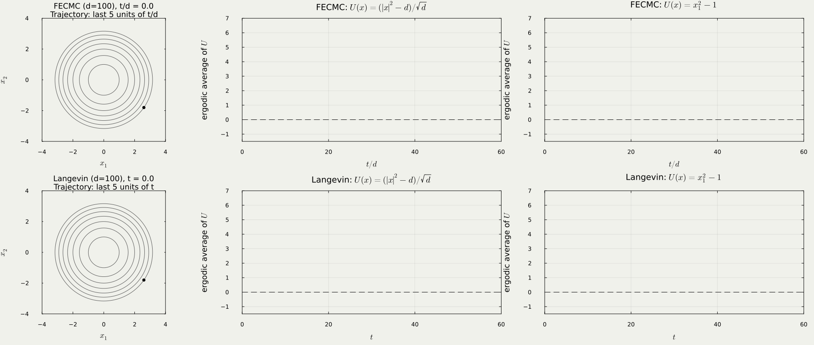
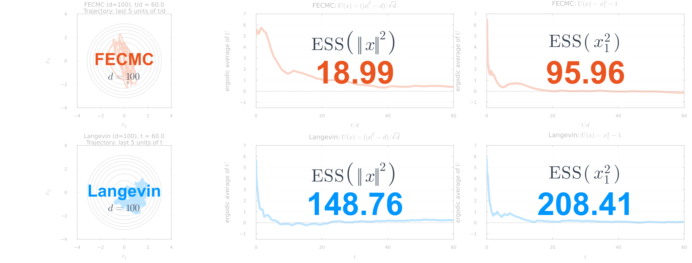

## Scaling Analysis of Two PDMPs {.unnumbered .unlisted}

* @sec-1 $\;$[Introduction]{.underline}:$\;$Energy / radial mixing in MCMC

* @sec-2 $\;$[Main Result]{.underline}:$\;$Analytic expression for Green--Kubo coefficient

    which leads to a rigorous ordering result, such as

    [**FECMC**]{.color-unite} always performs better than [**BPS**]{.color-blue}

* @sec-3 $\;$[Future direction]{.underline}:$\;$Asymptotic variance estimation (≒ ESS estimation)
  
  The **PDMP** framework allow a more efficient estimator

## MCMC Analysis in Statistics {#sec-1}

:::: {.columns style="text-align: center;"}
::: {.column width="33%"}
![[Markov Chain (1953--)]{.large-letter}](ISM/RWMH2.gif)
:::

::: {.column width="33%"}
![[Langevin Diffusion]{.medium-letter .color-blue} [(1978--)]{.large-letter .color-blue}](ISM/LMC.gif)
:::

::: {.column width="33%"}
![[PDMP (2008--)]{.large-letter .color-unite}](ISM/FECMC.gif)
:::
::::

### [**P**]{.color-unite}iecewise-[**D**]{.color-unite}eterministic [**M**]{.color-unite}arkov [**P**]{.color-unite}rocess (= statisticians' term for ECMC)

{fig-align="center"}

:::: {.columns style="text-align: center;"}

::: {.column width="45%"}
![[Langevin Diffusion]{.color-blue}](ISM/LMC_横長.gif)
:::

::: {.column width="45%"}
![[Randomized Hamiltonian Monte Carlo]{.color-unite}](ISM/RHMC_横長.gif)
:::

::::

### Markov Chain Monte Carlo

computes space averages as time averages

{fig-align="center"}

### Efficiency Depends on the Functionals {auto-animate=true auto-animate-duration="0.6"}

### Efficiency Depends on the Functionals {auto-animate=true auto-animate-duration="0.6"}

### Effective Sample Size