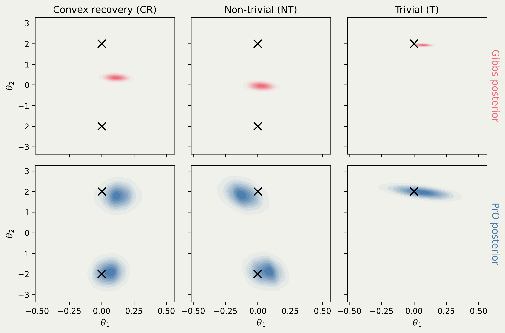
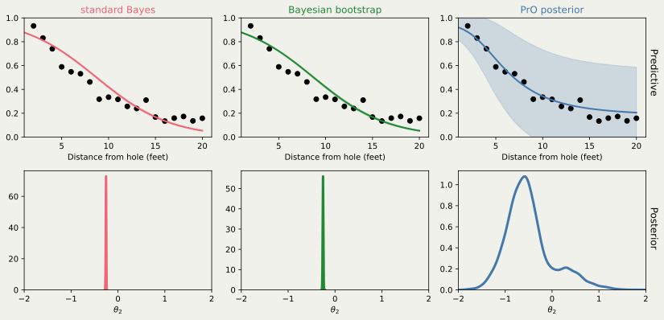
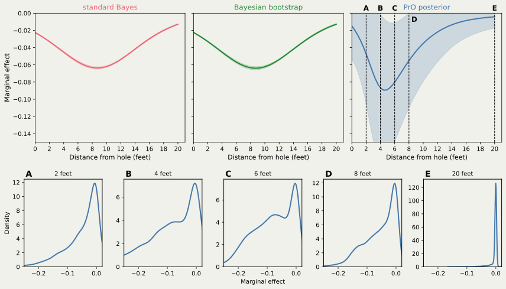
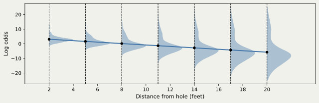

## 枠組みと使い方

めちゃくちゃ統計に使えるかもしれん……．

1. モデル誤特定が大標本極限で検出できる
2. Model check に使える情報をたくさん含んでいる

### ベイズの変分論的特徴付け

通常の Bayesian posterior は，次の分布空間上の最適化問題の解と見れる [@Zellner1988]：
$$
Q^*=
\operatorname*{arg\,min}_{Q\in\mathcal P(\Theta)}
\left\{
-\sum_{i=1}^n
\mathbb E_Q[\log p_\theta(x_i)]
+
\operatorname{KL}(Q\Vert\Pi)
\right\}.
$$

@Knoblauch+2022 は，

1. 一般の分布族 $\mathcal{Q}\subset\mathcal{P}(\Theta)$ (Variational Inference)
2. 一般の divergence $D$ [@Knoblauch+2022]
3. 一般の損失関数 $\ell$ [@Bissiri+2016]

を持った一般化を考える：
$$
Q^*=\operatorname*{arg\,min}_{Q\in\mathcal Q}
\left\{
\sum_{i=1}^n\mathbb E_Q[\ell(\theta,x_i)]
+D(Q\Vert\Pi)
\right\}.
$$

### Predictively Oriented Posterior の定義 (1/2)

Generalised Bayes / Gibbs posterior は一般の scoring rule $S$ と learning rate $\lambda_n$ に関して
$$
Q_n^{\mathrm{GB}}
=
\operatorname*{arg\,min}_{Q\in\mathcal P(\Theta)}
\left\{
\frac1n\sum_{i=1}^n
\int S(P_\theta,x_i)\,Q(d\theta)
+
\frac1{\lambda_n}
\operatorname{KL}(Q\Vert\Pi)
\right\}.
$$

@McLatchie+2026 は $S$ と積分の順番を入れ替える．$Q$-predictive を
$$
P_Q=\int P_\theta\,dQ(\theta)
$$
と定めると，
$$
Q_n^{\mathrm{PrO}}
=
\operatorname*{arg\,min}_{Q\in\mathcal P(\Theta)}
\left\{
\frac1n\sum_{i=1}^n
S(P_Q,x_i)
+
\frac1{\lambda_n}
\operatorname{KL}(Q\Vert\Pi)
\right\}.
$$

### Predictively Oriented Posterior の定義 (2/2)

$$
Q_n^{\mathrm{GB}}
=
\operatorname*{arg\,min}_{Q\in\mathcal P(\Theta)}
\left\{
\frac1n\sum_{i=1}^n
\int S(P_\theta,x_i)\,Q(d\theta)
+
\frac1{\lambda_n}
\operatorname{KL}(Q\Vert\Pi)
\right\}
$$
は $\lambda_n\to\infty$ のとき，誤特定下で１点に集中することが見えてる：
$$
\frac1n\sum_{i=1}^n\int S(P_\theta,x_i)\,dQ(\theta)\xrightarrow{n\to\infty}\iint S(P_\theta,x)\,P_0(dx)Q(d\theta)
$$
なので分布は次の１点 $\theta^*$ に集中する：
$$
\theta^*:=\operatorname*{arg\,inf}_{\theta\in\Theta}S(P_\theta,P_0).
$$
一方で PrO では $\{P_\theta\}$ の $Q$-mixture の中から選ばれる：
$$
Q^*\in\operatorname*{arg\,inf}_{Q\in\mathcal{P}(\Theta)}S(P_Q,P_0).
$$

### Illustration 1: Adaptive Concentration

分散 $\sigma^2=1$ 既知の Gaussian location family
$$
\mathcal M_{\Theta}:=\{N(\theta,1)\}
$$
と prior $\theta\sim N(0,1)$, squared MMD $S=\operatorname{MMD}^2$ を用いて，種々の母分布 $P_0$ を $n=10^3$ の大規模データから推定すると次の通り：

![Comparison of [PrO posterior predictives]{.color-blue} and [Gibbs posterior predictives]{.color-unite} in a well-specified and three misspecified regimes. Grey bars indicate a histogram of the observed data.](Predictive/mmd-illustrations.svg)

::: aside
[@McLatchie+2026 Section 2.1] このモデルについて，事後分布 $Q\mapsto P_Q$ 予測分布の対応は Gaussian smoothing になる．
:::

### Illustration 2: Robustness to Misspecification

説明変数 $z_i\overset{\text{iid}}{\sim}N_2(0,I_2)$ と正規誤差の線型モデル
$$
x_i=z_i^\top\theta+\varepsilon_i\qquad \varepsilon_i\overset{\text{iid}}{\sim}N(0,1)
$$
で $x_i$ を回帰し，prior $\theta\sim N_2(0,I_2)$, squared MMD $S=\operatorname{MMD}^2$ で推論する．

1. **Trivially Misspecified** (T): $P_{\theta^*}=P_{Q^*}$
  
    （例１）実は誤差の裾が重かった：$\varepsilon_i\overset{\text{iid}}{\sim}t_3$

2. **Nontrivially Misspecified** (NT): $P_{\theta^*}=P_{Q^*}$
  
    （例２）真の係数は $\theta_2=2$ と $\theta_2=-2$ に二峰性を持つものだった：
    $$
    \theta_2=2(-1)^{\xi_i} \quad\text{with}\quad \xi_i\overset{\text{iid}}{\sim}\operatorname{Ber}(1/2)
    $$

    （例２）だけを仮定した場合は $P_{0}=P_{Q^*}$ が成り立つ．これを **Convex Recovery** (CR) と呼ぶ．
    両方仮定すると $P_0\notin\operatorname{Conv}(P_Q)$．

### Illustration 2: Robustness to Misspecification

{fig-align="center"}

### Comparison 1: 大標本ロジスティック回帰で成功率予測

put の成功／失敗 $x\in\{0,1\}$ を距離 $z\in\mathbb{R}$ から予測するロジスティック回帰
$$
\operatorname{P}[X=1\,|\,z,\theta]=\big(1+\exp(\theta_1+\theta_2z)\big)^{-1}
$$
を考える．データは $n=5988$ [@Gelman-Nolan2002] で，Bayes 事後分布と Gibbs 事後分布はほとんど１点に集中する．

{fig-align="center"}

### Comparison 2: Model Check にものすごく使える！

:::: {.r-stack}
::: {.fragment .fade-out fragment-index=0}
$z$ の成功確率に与える marginal effect の事後平均を視覚化すると次の通り：
$$
\int_{\mathbb{R}^2}\frac{\partial\operatorname{P}[X=1\,|\,z,\theta]}{\partial z}\,Q(d\theta)
=\int_{\mathbb{R}^2}\theta_2\operatorname{P}[X=1\,|\,z,\theta]\operatorname{P}[X=0\,|\,z,\theta]\,Q(d\theta)
$$
:::

::: {.fragment .fade-in-then-out fragment-index=0}
> Unlike for the Bayes and Martingale posteriors, the marginal effects obtained from the PrO posterior at each distance are rich multimodal distributions, and [allow a more fine-grained model criticism]{.color-unite}.
:::

::: {.fragment fragment-index=1}
> [...] which once again reaffirms our previous observations: there seem to be [two relevant sub-groups in the data]{.color-unite}, and middle distances seem the most informative at discriminating between them.
:::

::::

{fig-align="center"}

### Comparison 3: Model Check にまだまだ使える

$$
\operatorname{Log-Odds}:=\log\frac{\operatorname{P}[X=1\,|\,z,\theta]}{\operatorname{P}[X=0\,|\,z,\theta]}=\theta_1+\theta_2z
$$

{fig-align="center"}

put の腕は長距離ではっきり分かれる．そのときの値で「上級者」が単離できるかもしれない．

→ mixture model を fit してプレイヤーを分類するという自然な後続解析が見えてくる．クラスターごとの log-odds の違いとかも出せるだろう．

## 計算

### 相関粒子系 / SMC への帰着

$\lambda_n$ を乗じて KL divergence を展開すると，目的関数は
$$
\mathcal{L}(Q):=\frac{\lambda_n}{n}\sum_{i=1}^nS(P_Q,x_i)-\int\log\pi(\theta)\,Q(d\theta)+\int\log q(\theta)\,Q(d\theta).
$$

この Wasserstein 勾配 $\nabla\mathcal{L}$ は各点 $Q\in\mathcal{P}_2(\Theta)$ で
$$
\nabla\mathcal{L}(Q)[\theta]=\lambda_n\mathcal{W}(Q)[\theta]-\nabla\log\pi(\theta)+\nabla\log q(\theta)
$$
というベクトル場になる．ただし $\frac{1}{n}\sum_{i=1}^nS(P_Q,x_i)$ の Wasserstein 勾配を $\mathcal{W}$ で表した．$\nabla\mathcal{L}$ に関する勾配流は
$$
d\Theta_t=-\bigg(\lambda_n\mathcal{W}(Q_t)(\Theta_t)-\nabla\log\pi(\Theta_t)\bigg)\,dt+\sqrt{2}\,dB_t
$$
が記述する分布の発展 $(Q_t)$ が満たす．この SDE は平均場近似によってシミュレートできる．

## References {.unlisted .unnumbered visibility="uncounted"}

::: {#refs}
:::

## 論文リスト {.unlisted .unnumbered visibility="uncounted" .small-slide}

1. [McLatchie, Cherief-Abdellatif, Frazier & Knoblauch (2026) Predictively Oriented Posterior (preprint)](https://arxiv.org/abs/2510.01915)

    誤特定があるとき大標本極限でも posterior distribution が一点に収束してほしくない．Predictively Oriented Posterior は予測性能から事後分布を再定義し，最適なモデル平均と誤指定を反映した不確実性を両立させる．応用は主にベイズ逆問題 [@Shen+2025] なのがつまらないと思ってるが，自分が唯一好きな @Lai+2026 の探索的な使い方を取り上げる．Transformer の in-context learning との関連も取り上げる [@Fu+2026]．

2. [Plummer (2015) Cuts in Bayesian Graphical Models (Statistics & Computing)](https://link.springer.com/article/10.1007/s11222-014-9503-z)

    信用できない変数からの影響を 'cut' するというモデリング手法が主題．prediction-powered inference やパネルデータからの因果推論への応用が好きなので取り上げる．doubly intractability という計算上の困難を引き起こすのが見どころ（ @Liu-Goudie2021 が有望な解決か？）他の面白い応用が @Bettaglia+2025 で，疫学モデルに加えて，中世英語の方言分布と文献成立地の同時推定を扱う．

3. [Samartsidis, Seaman, Harrison, Alexopoulos, Hughes, Rawlinson, Anderson, Charlett, Oliver & De Angelis (2024) A Bayesian Multivariate Factor Analysis Model for Causal Inference using Time-Series Observational Data on Mixed Outcomes (Biostatistics)](https://academic.oup.com/biostatistics/article/25/3/867/7459857)

    柔軟な動的因子モデルを観察データにフィッティングし，処置前のデータの外挿と処置後のデータとの差で因果効果の識別を狙う．
    データは COVID-19 濃厚接触者追跡で，どの政策が補足率を上げたかの政策評価をする．
    一番の見どころは「複数のアウトカムを同時にモデリングするベイズでやったことで因果効果を検出しやすくなった」という点，まさにベイズ階層モデルの悲願と思う．
    計算上も面白く，複雑な事後分布を simplified manifold MALA というアルゴリズムで解く．手法の深掘りとして @Vu+2026 を扱う．

<!--

4. [Franzolini, Beskos, De Iorio, Koziell & Grzeszkiewicz (2024) Change Point Detection in Dynamic Gaussian Graphical Models: The Impact of Covid-19 Pandemic on the U.S. Stock Market (Annals of Applied Statistics)](https://projecteuclid.org/journals/annals-of-applied-statistics/volume-18/issue-1/Change-point-detection-in-dynamic-Gaussian-graphical-models--The/10.1214/23-AOAS1801.short)

    COVID-19 のような株価の変動だけでなく業種間の依存構造そのものを一変させる市場ショックを，動的なグラフィカルモデルでベイズ推定し変化点検知を行う．
    「パンデミックによって流通・小売業が産業横断的な位置を占めるようになった」というような描像が見えてくるのが面白い．
    計算上の困難（特に Wishart 分布の正規化定数の近似）を極めて緻密な MCMC で解く（手法の基礎として @vandenBoom+2022 も扱う）．

5. [Goudie, Presanis, Lunn, De Angelis & Wernisch (2019) Joining and Splitting Models with Markov Melding (Bayesian Analysis)](https://projecteuclid.org/journals/bayesian-analysis/volume-14/issue-1/Joining-and-Splitting-Models-with-Markov-Melding/10.1214/18-BA1104.full)

6. [Finke, King, Beskos & Dellaportas (2019) Efficient Sequential Monte Carlo Algorithms for Integrated Population Models (Journal of Agricultural, Biological and Environmental Statistics)](https://link.springer.com/article/10.1007/s13253-018-00349-9)
-->
